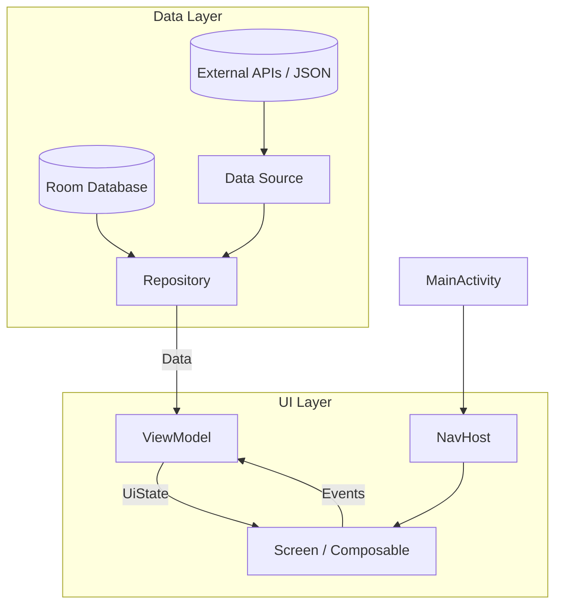

# Dokumentasjon av arkitektur

## Hensikt
Dette dokumentet er tiltenkt for personer som skal videreutvikle appen, sette seg inn i den og fortsette å jobbe med kodestil/ praksis som er brukt. Dokumentet beskriver hvilke strukturelle beslutninger som er tatt, hvordan prosjektet er strukturert og kodepraksisene som er fulgt gjennom utviklingen.

## Appens funksjon
Almanakken er en klima- app for bønder, folk med småbruk og andre som ønsker klimainnsikt for å drive med jordbruk. Appen lar brukerne se hvilke områder som er utsatt for ekstremvær basert på historisk data og få anbefalinger på vekstplaner for valgte områder fra nåtid og frem i tid.
I appen kan brukerne:
- Interagere med et kart som viser varsler for historisk data for flom, styrtregn og ekstrem vind.
- Se årlig historisk data for solskinnstimer, nedbør, luftfuktighet og temperatur per måned.
- Se anbefalinger av vekstplaner basert på prognostiserte klimaforhold
- Lagre favorittlokasjoner og legge ved notater til disse.
- Bytte mellom norsk og engelsk språk
- Bytte mellom lyst og mørkt tema

## Valg av SDK
Det valgte API- nivået for appen er minimum SDK på API 24. 
Det valgte API- nivået for appen er minimum SDK på API 33. Dette er valgt siden appen bruker moderne API-er som Google Maps SDK og Google Places der Geocoder er brukt for å konvertere adresser til posisjoner. 
Bønder i dag bruker mye moderne teknologi, så enhetene brukt av målgruppen vil i stor grad støtte denne løsningen.

## Eksterne API-er
- Frost API : Historiske klimadata (temperatur, luftfuktighet, nedbør, solskinnstimer)
- NVE API : Historisk flomdata
- Google Maps : Interaktivt kart med markører
- Google Places : Forslag på adresser i søkefelt
- Ktor : Nettverkstilgang

## Teknologi brukt
- Kotlin: Primært programmeringsspråk
- Jetpack Compose: Deklarativt UI- rammeverk
- Git/ GitHub: Versjonskontroll
- Room: Lokal database
- Google Maps SDK: Interaktivt kart og kart- markører
- Google Places API: Søk av posisjoner og forslag til auto- complete
- Vico: Tegning av klimagraf
- Apache Commons Math: Utregninger av regresjonsanalyse

## Prosjektets struktur
.
├── data/                        # Datalaget: Datakilder, repositories, lokal database  \
│   ├── exceptions/              # Egendefinerte unntak for håndtering av API-ene       \
│   ├── frost/                   # Frost API: Klima og observasjonsstasjoner            \
│   ├── local/                   # Room database                                        \
│   ├── network/                 # Ktor klient                                          \
│   ├── nve/                     # NVE API, datakilde og repository for flomvarsler     \
│   ├── plants/                  # Plante- repository                                   \
│   └── regression/              # Modell for lineær regresjon                          \
├── model/                       # Dataklasser                                          \
│   ├── favorites/                                                                      \
│   ├── frost/                                                                          \
│   ├── notes/                                                                          \
│   ├── nve/                                                                            \
│   └── plants/                                                                         \
├── ui/                          # UI- laget: Skjermer, @Composables, ViewModels        \
│   ├── customComposables/       # Egendefinerte @Composables                           \
│   ├── favorites/               # Favorittskjerm                                       \
│   ├── graphs/                  # Klimagrafskjerm                                      \
│   ├── home/                    # Hjem/ kartskjerm                                     \
│   ├── navigation/              # Navigasjonslogikk                                    \
│   ├── notes/                   # Notatskjerm                                          \
│   ├── settings/                # Innstillingskjerm                                    \
│   └── theme/                   # Tema, farger oversetting                             \
├── utils/                       # Utility-funksjoner for nettverkstilgang              \
├── MainActivity.kt              # Appens inngangspunkt, med meny for navigasjon        \
└── Team12Application.kt         # Initialisering av databaser                          

---

# Arkitektur
Appen følger Model - View - ViewModel (MVVM) arkitekturen med Unidirectional Data Flow (UDF).
Dataflyten fungerer overordnet slik: DataSource --> Repository --> ViewModel --> uiState --> UI. 
Eksempelvis vil svaret på et kall på klimadata fra grafskjermen se slik ut: FrostDataSource -> FrostRepository -> GraphScreenViewModel -> GraphScreenUiState -> GraphScreen.

Videre er prosjektet er delt opp i tre hovedmapper: Data, Model og UI.
- I data pakken ligger DataSources og Repositories for de ulike API-ene brukt og JSON-filene appen henter data fra. 
  Her ligger også exceptions som brukes for håndtering av unntak dersom kallene til Frost API ikke returnerer ønskede resultater, 
  og grensesnittet for roomdatabasen og de tre DAO-ene.
- I model- pakken ligger alle data- og enum-klasser som brukes i appen.
- I ui- pakken ligger alle skjermer og komponenter som brukes i appen, med deres respektive viewModels, 
  samt en theme- pakke med verdier for farger, tema og tekst. 
  Her ligger også navigation- pakken som holder styr på navigasjon i appen.

## Dataflow

## UDF
Alle skjermer har en har en egen "uiState"- dataklasse som representerer hele uiState-en for den skjermen. Skjermens ViewModel henter staten via MutableStateFlow.
UI- en gir beskjed for handlinger ved å kalle på ViewModelen sine funksjoner. ViewModelen behandler så handlingene og oppdaterer uiState-en som UI-en observerer via collectAsState(). Slik opprettholdes UDF.

## Sentrale strukturelle valg
- Flomvarsler: For å øke innlastingstiden til appen, hentes historisk flomdata fra NVE API kun når appen starter opp og caches i HomeScreenUIState. 
  Dette gjøres siden dataen er historisk og endrer seg minimalt over korte tidsperioder. Siden det kun opprettes én instans av hver viewmodel, beholdes 
  verdiene og ved hver rekomponering, og redundante API- kall er ikke nødvendig.

- Klimadatavarsler: Dataen som ligger til grunn for å vise symboler for styrtregn og ekstremvind er hentet fra frost ligger lagret i '/res/raw/high_wind_speed_stations.json og /res/raw/torrential_rain_stations.json' 
  Dette er gjort siden API- kallet som henter dataen er svært omfattende og tidkrevende. For å kunne levere nødvendig informasjon til brukerne, er dette hentet fra frost API-et på forhånd og lagret lokalt.

- Klimadata på grafskjermen: Dataen hentet fra frost API-et caches og lagres i tre maps inne i GraphScreenViewModel. 
  Igjen gjøres dette siden historisk data ikke endrer seg og man unngår redundante API- kall hver gang brukeren endrer valg av klimadata eller måned inne på grafskjermen.
  Når metoden setMarkerPositionAndFetch() blir dataen klartert før den henter data fra ny posisjon.

- Det er opprettet en lokal room- database der brukerne kan lagre generelle innstillinger, favorittlokasjoner, og personlige notater. 
  Vi har valgt denne løsningen for å opprettholde personvern og sikre at kun brukeren selv har tilgang til sin egen persondata,
  og for å øke brukeropplevelsen ved at dataen vedvarer etter lukking av applikasjonen. 
  

--- 

## Kodestil
- All kode (funksjoner, variabler, kommentarer)er skrevet på engelsk.
- Alle variabelnavn er skrevet i **camelCase**, alle klasser er skrevet i **PascalCase**
- UI state er representert ved dataklasser og oppdateres med .copy()
- All forretningslogikk ligger i ViewModels og er separert fra @Composables
- Strenger er representert som stringResources og ligger i 'res/values/strings-en.xml' for engelsk og i 'res/values-nb-rNO/strings.xml' for norsk bokmål. 
