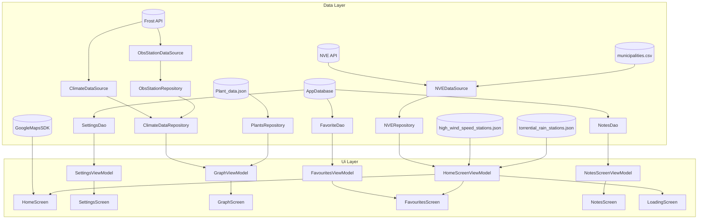
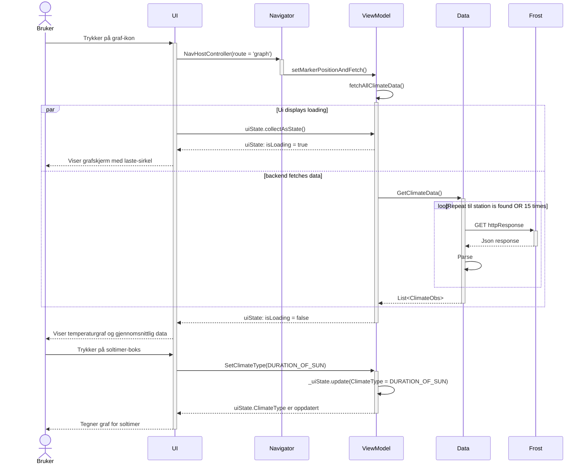
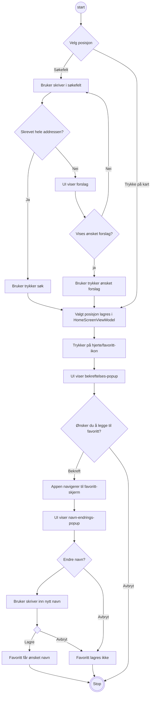

## Arkitekturskisse

Vi valgte å inkludere en aktitekturskisse fordi det gir et godt innblikk i hvordan data flyter gjennom applikasjonen, og gir en god visualisering av inndelingen med data- og UI-lag.

I datalaget ser vi hvordan data flyter fra API-ene Frost og NVE til DataSource og videre til Repositories. Vi ser også hvor data fra lokale filer blir behandlet. 
I tillegg har vi en lokal Room-database med tre forskjellige DAO-er. Data fra alle disse kildene flyter gjennom datalaget, og blir cashet i ViewModels i UI-laget

I UI-laget har alle skjermene hver sin ViewModel. ViewModelene for innstillinger, favoritter og notater får sin data fra hver sin DAO. GraphScreenViewModel får data fra ClimateDataRepository og PlantRepository
, for å kunne vise grafen, gjennomsnittsverdier og en planteprognose på GraphScreen.
HomeScreen sin ViewModel får data fra både NVE og lokale filer for vind og regn, for å kunne vise symboler på kartet. For kartvisningen i HomeScreen har vi brukt Google Maps SDK.

## Sekvensdiagram
### Bruker ønsker å vise graf for soltimer på valgt område

Vi har også valgt å inkludere et sekvensdiagram, for å tydeligjøre hva som faktisk skjer når bruker ønsker å få opp riktig data på grafskjermen.

Senarioet starter med at bruker trykker på et graf-ikon, som fører til et kall på ViewModel for å hente data, samtidig som appen navigerer til 
graf-skjermen og viser en laste-sirkel. Her vil UI samle state hos ViewModel, som gjør at den viser data basert på hva som er i ViewModel. 

Mens UI viser laste-sirkelen, blir dataen hentet i datalaget. Det gjøres ved hjelp av en loop som kjører til
brukbar data returneres, hvis ikke "gir den opp" etter 15 forsøk og kaster en Exception. Om daten er brukbar vil en liste med klima-observasjoner bli
cashet i ViewModel, og UI vil vise grafen over historiske temperatur-data.

Deretter trykker bruker på boksen med et sol-ikon. Da vil UI kalle på setClimateType() i viewModel (som allerede har denne daten cashet), og oppdatere uiStaten.
Siden UI følger med på uiStaten i ViewModel vil UI reagere med å vise bruker den riktige grafen for sol-timer.

## Aktivitetsdiagram
### Bruker ønsker å legge til en posisjon som favoritt

Vi valgte også å inkludere et aktivitetsdiagram for å vise flyten for hvordan man legger til en favoritt fra brukerens perspektiv.

Navn: Bruker ønsker å legge til en posisjon som favoritt
Aktør: Bruker.
Prebetingelse: Internett-tilgang. Være på hjem-skjermen.
Postbetingelse: En favoritt er opprettet, og lagret i databasen.
Hovedflyt:
1. Bruker trykker på ønsket område på kart
2. Appen lagrer posisjonen i HomeScreenViewModel
3. Bruker trykker på favoritt-ikonet
4. UI viser bekreftelses-popup
5. Bruker trykker på bekreft
6. Appen navigerer til favoritt-skjerm
7. UI viser navn-endrings-popup
8. Bruker skriver inn nytt navn
9. Bruker trykker Lagre
10. Favoritt får ønsket navn og blir lagret i databasen.

Alternativ flyt 1:\
1a Bruker skriver hele addressen i søkefelt\
1b Bruker trykker søk\

Alternativ flyt 2:\
1aa Bruker skriver inn deler av addressen i søkefeltet\
1ab UI viser ønsket forslag\
1ac Bruker trykker på ønsket forslag\

## Use Case Diagram

Mermaid egner seg ikke til å lage Use case diagrammer, så denne er lagt til i ExternalPrograms/UseCase.png.

Case 1: Se klimadata for valgt posisjon \
Aktør: Hageentusiast, Bonde\
Beskrivelse: Brukeren velger en posisjon og får opp klimadata for denne. Brukeren kan velge å se data i år eller bla bakover i tid for å se 
historiske klimadata.
include-->Se gjennomsnitter: Gjennomsnitter vises alltid som en del av klimavisningen
extend--> Brukeren kan valgfritt se historisk klimadata for de ulike klimatypene

Case 2: Legge til og lagre adresser\
Aktør: Hageentusiast, Bonde\
Beskrivelse: Brukeren kan søke opp eller markere en adresse og lagre den som favoritt for rask tilgang senere.
extend --> Søk opp addresse / Velg posisjon: brukeren kan velge mellom å skrive inn en addresse i søkefeltet, eller å trykke på en posisjon på kartet.

Case 3: Skrive og lagre notater\
Aktør: Hageentusiast, Bonde\
Beskrivelse: Brukeren kan skrive notater og lagre notater.

Case 4: Se hvilke planter som kan overleve på valgt posisjon\
Aktør: Hageentusiast, Bonde\
Beskrivelse: Brukeren få opp forslag til tre planter som kan overleve i valgt klima.
include --> Se planter som kan overleve i år: Planter som kan overleve i år vises som en del av klimavisningen
extend --> Planter som kan overleve i framtiden: Bruker kan velge å se hvilke planter som kan overleve i antatt klima framover i tid, basert på en regresjonsanalyse av tilgjengelig klimadata.

Case 5: Se områder på kart som er spesielt utsatt for naturhendelser\
Aktør: Bonde\
Beskrivelse: Brukeren får opp steder som er spesielt utsatt for flom, styrtregn eller ekstrem vind på kart.

