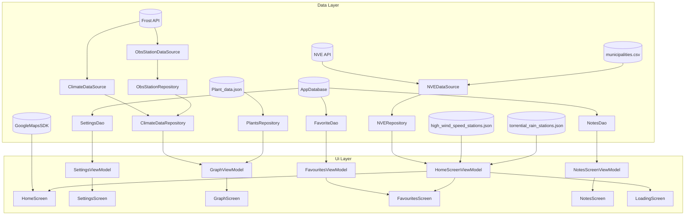
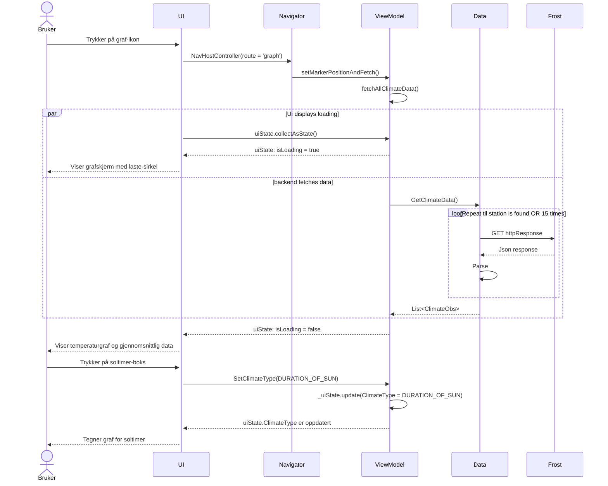
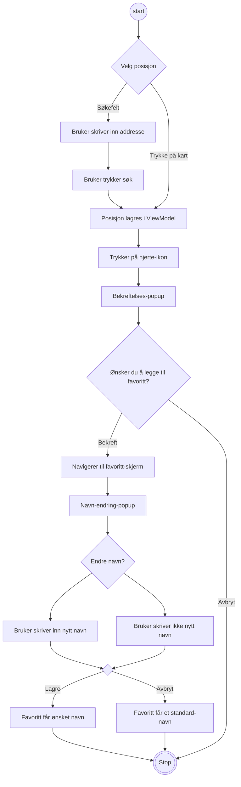

## Arkitekturskisse

Vi valgte å inkludere en aktitekturskisse fordi det gir et godt innblikk i hvordan data flyter gjennom applikasjonen, og gir en god visualisering av inndelingen med data- og UI-lag.

I datalaget ser vi hvordan data flyter fra API-ene Frost og NVE til DataSource og videre til Repositories. Vi ser også hvor data fra lokale filer blir behandlet. 
I tillegg har vi en lokal Room-database med tre forskjellige DAO-er. Data fra alle disse kildene flyter gjennom datalaget, og blir cashet i ViewModels i UI-laget

I UI-laget har alle skjermene hver sin ViewModel. ViewModelene for innstillinger, favoritter og notater får sin data fra hver sin DAO. Graph sin ViewModel får data fra ClimateDataRepository og PlantRepository.
HomeScreen sin ViewModel får data fra både NVE og lokale filer for vind og regn, for å kunne vise symboler på kartet. For kartvisningen i HomeScreen har vi brukt Google Maps SDK.

## Sekvensdiagram
### Bruker ønsker å vise graf for soltimer på valgt område

Forklaring for sekvensdiagram

## Aktivitetsdiagram
### Bruker ønsker å legge til en posisjon som favoritt

Forklaring for aktivitetsdiagram